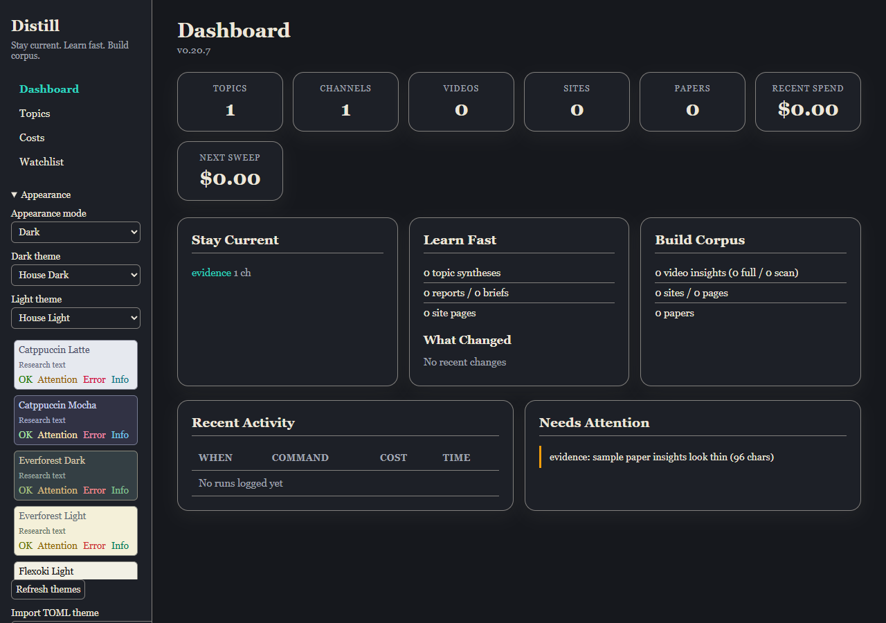
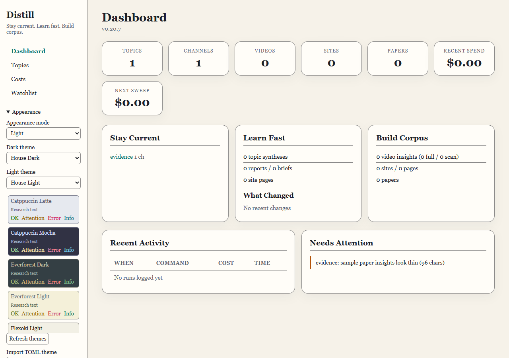

# Appearance and themes

The web desk and exported dashboard share the same theme tokens and component
stylesheet. First use opens House Dark. Appearance offers Dark, Light and
System, with a separate palette for each variant. Choices persist in this
browser's local storage. System follows the browser's color-scheme preference.
The blocking theme script selects the stored palette before first paint; the
live server retains its same-origin script restriction.

The twelve built-in palettes are House Dark, House Light, Tokyo Night,
Catppuccin Mocha, Gruvbox Material Dark, Everforest Dark, Nord, Kanagawa Wave,
Green Screen, Catppuccin Latte, Flexoki Light and Everforest Light. Preview cards
show actual text and status roles. Transitions take about 300 ms and are
instant when reduced motion is requested. Command examples have a Copy button
and a spoken status announcement.

## Add a palette

Open Appearance to import a TOML file, or use the CLI:

```console
distill theme list
distill theme install ./my-theme.toml
distill theme install https://github.com/owner/distill-example-theme
distill theme update
distill theme remove my-theme
```

The GitHub URL above illustrates the required repository shape. It is not a
bundled public theme repository. Only HTTPS `github.com/owner/repo` URLs are
accepted. Installation downloads a bounded archive through the hardened fetch
path. It does not clone, execute hooks, run scripts, install dependencies, or
import CSS. This deliberately narrows #56's proposed git-clone mechanism.
Theme identity comes from its validated declared slug, not the repository name.

User palettes live under `$XDG_CONFIG_HOME/distill/themes`, or the existing
platform configuration directory. A file dropped there appears after Refresh
themes, without restarting the server. The filename must match its slug.
Repository updates use their recorded source. Removal touches user themes;
built-in palettes cannot be replaced or removed. Failed validation or publication
preserves the earlier file. A missing or invalid selected palette falls back to
the house palette for its variant and displays a notice. Standalone exports
embed a snapshot of installed palettes; regenerate an export to include changes.

## TOML contract

Start from a file in [the built-in theme directory](../distill/web/themes/).
Required metadata is `name`, `slug`, and `variant` (`dark` or `light`). Optional
metadata is `author`, `source`, and `license`. A slug is 1 to 64 ASCII characters
matching `[a-z0-9_][a-z0-9._+-]*`.

The `[colors]` table requires `bg`, `surface`, `text`, `muted`, `accent`,
`success`, `warning`, `error`, `info`, and `selection`. Values are strict
`#rrggbb` strings. `[colors.optional]` accepts `surface-raised`, `border`,
`on-accent`, `focus`, and decorative `rule`; absent roles are derived.
Unknown fields, malformed values, files above 16 KB, unsafe paths, and ambiguous
slugs are refused. Archives are bounded to 8 MB, 2,000 entries and 20 themes.
Non-TOML files and symlinks are ignored and named in the report.

Every load checks text and muted text at 4.5:1 on the canvas, surface and
selection; accent and status text at 4.5:1 on canvas and surface; focus and input
borders at 3:1; and text on accent at 4.5:1. Success and error must differ by
at least 60 degrees of OKLCH hue or 0.15 lightness. Status, focus, and border
repairs preserve hue and chroma while shifting lightness and are reported.
Unreadable body text and colliding status roles are refused.

The terminal follows its own configured colors, with ANSI cyan, green, yellow,
red, blue and dim roles. It has no web appearance setting. `NO_COLOR` retains
state words; routine commands do not clear history or play an animation.

## House palette previews

These screenshots use a synthetic local library, with Appearance open. They
show the same dashboard in its default dark palette and its paper light palette.





The [maintenance validation record](research/maintenance-2026-10-17.md)
separates automated contrast and browser checks from semantic research quality.
